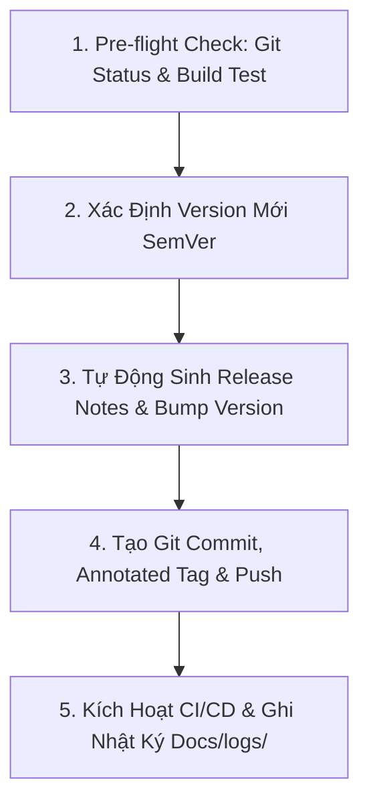

# 🚀 Deploy App Skill - Quy Trình Phát Hành Phiên Bản Mới

Skill này cung cấp quy trình tự động hóa toàn diện từ chuẩn bị, kiểm thử, nâng phiên bản (Semantic Versioning), sinh Release Notes chi tiết và đẩy Git Tag lên GitHub để kích hoạt CI/CD tự động xuất bản APK cho tính năng Auto-Update.

---

## ⚡ Quy Trình 5 Bước Phát Hành Chuẩn



---

### Bước 1: Kiểm Tra Trước Phát Hành (Pre-flight Checks)
1. Đảm bảo toàn bộ thay đổi mã nguồn trước đó đã được hoàn thiện.
2. Kiểm tra biên dịch bằng lệnh:
   ```powershell
   .\gradlew.bat compileDebugKotlin
   ```
   *(Đảm bảo kết quả BUILD SUCCESSFUL trước khi tiến hành bước tiếp theo).*

---

### Bước 2: BẮT BUỘC - Khởi Tạo Log Truy Vết (`Docs/logs/`)
Trước khi thực hiện release, tạo bản ghi nhật ký:
```powershell
powershell -ExecutionPolicy Bypass -File .agents/skills/swarm-dispatch/scripts/init_log.ps1 -TaskSlug "release_v<version>" -TaskTitle "Phát hành phiên bản ứng dụng v<version>" -AgentName "lead-architect"
```

---

### Bước 3: Thực Hiện Deploy Bằng Script Tự Động (`scripts/deploy.ps1`)

Sử dụng script tiện ích tự động hóa các thao tác cập nhật `app/build.gradle.kts`, sinh Release Notes, commit, tạo tag và đẩy lên GitHub:

#### 1. Phát hành bản vá lỗi (Patch: 1.0.0 -> 1.0.1)
```powershell
powershell -ExecutionPolicy Bypass -File .agents/skills/deploy-app/scripts/deploy.ps1 -BumpType patch -ReleaseTitle "Vá lỗi và cải thiện độ ổn định"
```

#### 2. Phát hành bản tính năng mới (Minor: 1.0.0 -> 1.1.0)
```powershell
powershell -ExecutionPolicy Bypass -File .agents/skills/deploy-app/scripts/deploy.ps1 -BumpType minor -ReleaseTitle "Bổ sung tính năng mới" -ReleaseNotes "- Thêm Equalizer 5 băng tần`n- Nâng cấp cử chỉ vuốt MiniPlayer"
```

#### 3. Chạy thử nghiệm không ghi đĩa (Dry Run)
```powershell
powershell -ExecutionPolicy Bypass -File .agents/skills/deploy-app/scripts/deploy.ps1 -BumpType patch -DryRun -SkipTest
```

#### Các tham số của script `deploy.ps1`:
| Tham số | Ý nghĩa | Mặc định |
| :--- | :--- | :--- |
| `-BumpType` | Loại nâng cấp: `patch`, `minor`, `major`, `custom` | `patch` |
| `-CustomVersion` | Phiên bản chỉ định thủ công khi dùng `custom` (VD: `1.2.0`) | `""` |
| `-ReleaseTitle` | Tiêu đề cho bản phát hành | Tự động |
| `-ReleaseNotes` | Nội dung mô tả chi tiết các thay đổi | Tự động trích xuất từ git log |
| `-DryRun` | Chạy mô phỏng, không ghi đè file, không commit hay push | `$false` |
| `-SkipTest` | Bỏ qua bước chạy kiểm tra biên dịch trước khi deploy | `$false` |
| `-SkipPush` | Chỉ commit và tạo tag cục bộ, không push lên GitHub | `$false` |

---

### Bước 4: Kiểm Tra Tự Động Hóa CI/CD & GitHub Releases
1. Khi script đẩy tag `v*` (ví dụ `v1.0.1`) lên GitHub:
   - Workflow [`.github/workflows/release.yml`](../../.github/workflows/release.yml) sẽ tự động kích hoạt trên GitHub Actions.
   - Hệ thống tự động build file APK và tải đính kèm vào mục **Releases** của repository: `https://github.com/khuongnv/android_music_player/releases`.
2. Kiểm tra tính năng Auto-Update trong ứng dụng:
   - Mở ứng dụng -> **Settings** -> Nhấn **Check for Updates**.
   - Hộp thoại Apple Music sẽ hiển thị bản cập nhật mới kèm Release Notes vừa phát hành.

---

### Bước 5: Đóng Nhật Ký Truy Vết & Báo Cáo
1. Cập nhật nội dung chi tiết vào `Docs/logs/YYYY-MM-DD_release_v<version>.md`:
   - Ghi nhận phiên bản cũ và mới (`versionCode`, `versionName`).
   - Ghi nhận nội dung Release Notes đã đính kèm.
   - Đánh dấu trạng thái `✅ Hoàn thành`.
2. Cập nhật bảng tổng hợp [`Docs/logs/README.md`](../../Docs/logs/README.md).
3. Báo cáo kết quả phát hành cho người dùng.
