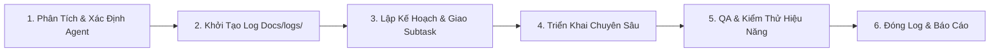

# 🐝 Swarm Dispatch Skill - Quy Trình Giao Việc & Điều Phối Swarm

Skill này hướng dẫn quy trình tiêu chuẩn để tiếp nhận yêu cầu từ người dùng, phân tách nhiệm vụ, giao việc cho các Swarm Subagents chuyên trách, giám sát chất lượng và tự động duy trì nhật ký truy vết (`Docs/logs/*.md`).

---

## ⚡ Quy Trình 6 Bước Giao Việc & Thực Thi



---

### Bước 1: Tiếp Nhận & Phân Luồng Yêu Cầu
1. Đọc kỹ yêu cầu từ người dùng (`USER_REQUEST`).
2. Tra cứu [Ma Trận Điều Phối (Dispatch Matrix)](./references/dispatch_matrix.md) để xác định Agent chủ trì và các Agent phối hợp:
   - **`media-playback-specialist`**: Âm thanh, ExoPlayer, MediaSession, AudioFocus, Notification, Sleep Timer, Equalizer.
   - **`compose-ui-specialist`**: Màn hình Compose, Apple Music layout, MiniPlayer, Theme, Animation, Coil artwork.
   - **`storage-data-specialist`**: MediaStore scan, Room Database, DataStore, Scoped Storage permissions.
   - **`qa-perf-specialist`**: Kiểm thử, rò rỉ RAM (Bitmap), tiết kiệm pin Doze Mode, Gradle test & build.
   - **`lead-architect`**: Tính năng lớn xuyên suốt nhiều tầng, tái cấu trúc hoặc thay đổi Hilt/NavGraph.

---

### Bước 2: BẮT BUỘC - Khởi Tạo Nhật Ký Truy Vết (`Docs/logs/`)
> [!IMPORTANT]
> Tuyệt đối không bắt tay vào sửa code khi chưa khởi tạo file log truy vết.

Chạy lệnh PowerShell sau để tự động tạo tệp log và đưa vào chỉ mục [`Docs/logs/README.md`](../../Docs/logs/README.md):
```powershell
powershell -ExecutionPolicy Bypass -File .agents/skills/swarm-dispatch/scripts/init_log.ps1 -TaskSlug "<slug_ngan_gon>" -TaskTitle "<Tên_nhiệm_vụ>" -AgentName "<ten_agent>"
```
*Ví dụ*:
```powershell
powershell -ExecutionPolicy Bypass -File .agents/skills/swarm-dispatch/scripts/init_log.ps1 -TaskSlug "add_equalizer_ui" -TaskTitle "Thêm giao diện Equalizer cho trình phát nhạc" -AgentName "compose-ui-specialist"
```
*(Nếu môi trường không chạy được script, tạo thủ công tệp `Docs/logs/YYYY-MM-DD_<slug>.md` dựa theo [Log Template](./resources/log_template.md) và thêm dòng tương ứng vào `Docs/logs/README.md`).*

---

### Bước 3: Phân Bổ Nhiệm Vụ (Subtask Allocation)
- Nếu là tác vụ đơn giản: Agent chủ trì tiến hành thực hiện.
- Nếu là tác vụ phức tạp liên module (VD: Equalizer vừa có logic âm thanh, vừa có UI, vừa lưu DataStore):
  - Dùng công cụ `invoke_subagent` để triệu hồi subagent chuyên môn:
    - Triệu hồi `media-playback-specialist` phụ trách audio pipeline.
    - Triệu hồi `compose-ui-specialist` phụ trách giao diện Compose.
    - Triệu hồi `storage-data-specialist` phụ trách lưu trữ cấu hình.
  - Giao rõ ràng: Mục tiêu cần đạt, tệp tin cần sửa, hợp đồng dữ liệu đầu vào/đầu ra.

---

### Bước 4: Triển Khai Chuyên Sâu & Giữ Vững Kiến Trúc
Mỗi agent khi thực hiện phải tuân thủ:
1. **Clean Architecture**:
   - `ui` phụ thuộc `domain` (thông qua ViewModel và UseCase).
   - `data` triển khai Repository interface từ `domain`.
   - `domain` thuần túy Kotlin, độc lập với Android UI.
2. **Apple Music Style**:
   - Góc bo tròn, hiệu ứng mờ nhạt (glassmorphism/blur), màu sắc tinh tế, phông chữ rõ ràng.
3. **Async an toàn**:
   - Mọi I/O trên `Dispatchers.IO`, UI trên `Dispatchers.Main.immediate`.
   - Giải phóng tài nguyên đúng thời điểm (`onCleared`, `onDestroy`).

---

### Bước 5: Kiểm Thử & Đánh Giá Chất Lượng (QA Review)
Trước khi kết thúc, `qa-perf-specialist` (hoặc agent chủ trì) rà soát:
- Kiểm tra tính toàn vẹn của mã nguồn Kotlin.
- Chạy thử nghiệm build kiểm tra (ví dụ: `./gradlew testDebugUnitTest` hoặc xác minh cú pháp).
- Rà soát nguy cơ rò rỉ RAM (Bitmap, Audio Focus listener, Service connection).
- Đảm bảo Foreground Service không bị kill ngầm bất thường.

---

### Bước 6: Hoàn Thiện Log & Báo Cáo Kết Quả
1. Cập nhật nội dung chi tiết vào file log `Docs/logs/YYYY-MM-DD_<slug>.md`:
   - Điền đầy đủ mục **2. Chi Tiết Các Bước Thực Hiện**.
   - Điền danh sách tệp thay đổi tại mục **3. Danh Sách Tệp Thay Đổi**.
   - Điền kết quả kiểm thử tại mục **4. Kiểm Thử & Xác Minh**.
   - Chuyển `Trạng thái: 🔄 Đang tiến hành` thành `Trạng thái: ✅ Hoàn thành`.
2. Cập nhật trạng thái thành `✅ Hoàn thành` trong [`Docs/logs/README.md`](../../Docs/logs/README.md).
3. Báo cáo tổng kết cho người dùng kèm các đường dẫn liên kết đến tệp mã nguồn và tệp log.
