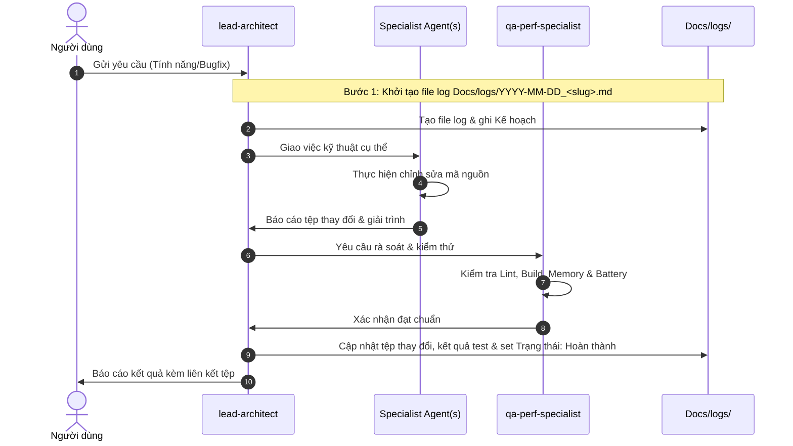

# 🧭 Ma Trận Điều Phối Nhiệm Vụ (Swarm Dispatch Matrix)

Ma trận này dùng để xác định chính xác Agent chịu trách nhiệm chính và các Agent hỗ trợ dựa trên loại tác vụ và gói mã nguồn bị ảnh hưởng trong dự án **Android Offline Music Player**.

---

## 1. Phân Luồng Theo Lĩnh Vực Chuyên Môn

| Lĩnh vực | Agent Phụ Trách Chính | Agent Phối Hợp | Thư Mục / Tệp Trọng Tâm |
| :--- | :--- | :--- | :--- |
| **Kiến trúc & Tái Cấu Trúc Tổng Thể** | `lead-architect` | Toàn bộ Swarm | `domain/`, `di/AppModule.kt`, `NavGraph.kt` |
| **Audio Engine, Media3 & Background Service** | `media-playback-specialist` | `storage-data` (State), `qa-perf` (Focus/Battery) | `player/MusicService.kt`, `player/MusicServiceConnection.kt`, `util/MediaItemExtensions.kt` |
| **Equalizer & Hiệu Ứng Âm Thanh** | `media-playback-specialist` | `compose-ui` (Slider UI), `storage-data` (Presets) | `player/*`, `ui/screens/*` |
| **Giao Diện Compose & Animation Apple Music** | `compose-ui-specialist` | `media-playback` (Progress), `qa-perf` (FPS/Recomposition) | `ui/screens/*`, `ui/components/*`, `ui/theme/*` |
| **MiniPlayer & Cử Chỉ Vuốt / BottomSheet** | `compose-ui-specialist` | `media-playback-specialist` | `ui/components/MiniPlayer.kt`, `ui/screens/nowplaying/` |
| **Quét Nhạc Cục Bộ & Scoped Storage** | `storage-data-specialist` | `compose-ui` (Loading UI), `qa-perf` (Perf) | `data/local/mediastore/`, `data/local/scanner/`, `util/MediaScannerUtil.kt` |
| **Cơ Sở Dữ Liệu Room & Danh Sách Phát** | `storage-data-specialist` | `lead-architect` (UseCase) | `data/local/room/*`, `domain/repository/PlaylistRepository.kt` |
| **Lưu Trữ Trạng Thái (DataStore)** | `storage-data-specialist` | `media-playback-specialist` | `data/repository/PlayerStateRepositoryImpl.kt` |
| **Kiểm Thử & Đảm Bảo Chất Lượng** | `qa-perf-specialist` | Agent viết code tương ứng | `test/`, `androidTest/`, ProGuard, build.gradle |
| **Tối Ưu Pin & Memory Leak (Bitmap OOM)** | `qa-perf-specialist` | `compose-ui` (Coil), `media-playback` (Service) | `player/CoilBitmapLoader.kt`, Service lifecycle |

---

## 2. Quy Trình Phối Hợp Chéo (Cross-Agent Contract)

