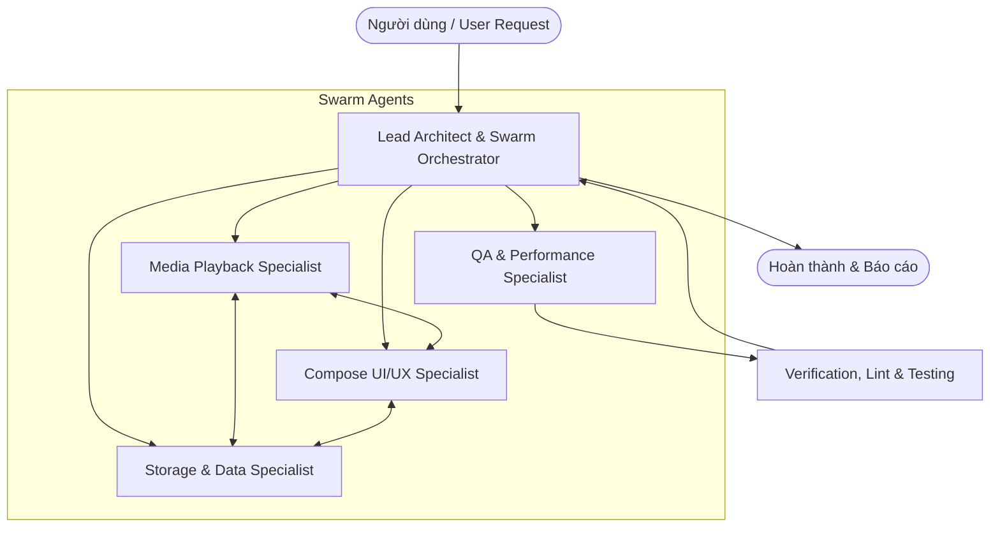

# Android Offline Music Player - Swarm Agent System & Guidelines

Chào mừng đến với hệ thống Swarm Agent dành cho dự án **Android Offline Music Player**.
Dự án được xây dựng theo phong cách thiết kế **Apple Music**, thuần offline, tối ưu hóa hiệu năng, âm thanh độ trễ thấp và trải nghiệm người dùng cao cấp.

---

## 🐝 1. Kiến trúc Swarm Agent (Multi-Agent Swarm)

Hệ thống swarm bao gồm 5 Agent chuyên trách phối hợp chặt chẽ:



### Chi tiết vai trò từng Agent:

### 1. `lead-architect` (Lead Android Architect & Orchestrator)
- **Nhiệm vụ chính**: Phân tích yêu cầu, chia nhỏ tính năng thành các subtasks, điều phối các agent chuyên trách, duy trì tính nhất quán kiến trúc.
- **Phạm vi kiểm soát**: Clean Architecture (Presentation - Domain - Data), Hilt Modules (`di/AppModule.kt`), Navigation graph (`ui/navigation/NavGraph.kt`), code review tổng thể.
- **Tiêu chuẩn**: Đảm bảo không vi phạm quy tắc phụ thuộc (Domain không phụ thuộc Android framework hoặc Data/UI layer).

### 2. `media-playback-specialist` (Media3 & Audio Engine Specialist)
- **Nhiệm vụ chính**: Xử lý toàn bộ logic liên quan đến phát nhạc, audio pipeline, background service.
- **Phạm vi kiểm soát**: 
  - `androidx.media3` (`media3-exoplayer`, `media3-session`, `media3-ui` 1.2.1+).
  - `MusicService.kt` (`MediaSessionService`, `MediaNotificationManager`, notification controls).
  - `MusicServiceConnection.kt` (cầu nối kết nối ViewModel với Service).
  - Quản lý Audio Focus (cuộc gọi đến, tai nghe rút ra `ACTION_AUDIO_BECOMING_NOISY`, ducking).
  - Các tính năng: Sleep Timer, Shuffle, Repeat (Off / One / All), Seek, Gapless playback, Equalizer / Audio effects.
- **Tiêu chuẩn**: Thread-safe (Player chỉ tương tác từ Main thread), giải phóng tài nguyên triệt để khi hủy Service.

### 3. `compose-ui-specialist` (Jetpack Compose & UI/UX Specialist)
- **Nhiệm vụ chính**: Thiết kế và tối ưu giao diện theo chuẩn Apple Music.
- **Phạm vi kiểm soát**:
  - `ui/screens/*` (`NowPlayingScreen`, `LibraryScreen`, `SongsScreen`, `AlbumsScreen`, `AlbumDetailScreen`, `PlaylistsScreen`, `SearchScreen`, `SettingsScreen`).
  - `ui/components/*` (`MiniPlayer`, `BottomNavBar`, `SongItem`, `AlbumCard`).
  - `ui/theme/*` (`Theme.kt`, `Color.kt`, `Type.kt`) hỗ trợ Dark / Light dynamic theme.
  - Hiệu ứng chuyển động (motion/spring animations), cử chỉ swipe MiniPlayer, blur background artwork.
  - Tối ưu Recomposition: Sử dụng `remember`, `derivedStateOf`, immutable state, `key` trong `LazyColumn`/`LazyVerticalGrid`.
- **Tiêu chuẩn**: 60/120 FPS mượt mà, layout bo tròn hiện đại, hiển thị artwork chất lượng cao với Coil.
- **Quy chuẩn UI/UX bắt buộc**: Tuân thủ nghiêm ngặt [Quy tắc UI/UX Apple Music](.agents/rules/ui-ux-apple-music.md) và [Cẩm nang Style Guide](Docs/UI_UX_STYLE_GUIDE.md).

### 4. `storage-data-specialist` (Storage, MediaStore & Room Specialist)
- **Nhiệm vụ chính**: Quản lý dữ liệu cục bộ, quét nhạc, quyền truy cập tệp và cơ sở dữ liệu.
- **Phạm vi kiểm soát**:
  - `data/local/mediastore/MediaStoreDataSource.kt` & `util/MediaScannerUtil.kt`: Quét tệp âm thanh nội bộ với ContentResolver, MediaStore API.
  - Quản lý quyền: `READ_MEDIA_AUDIO` (Android 13+ / API 33+) và `READ_EXTERNAL_STORAGE` (Android 12 trở xuống).
  - `data/local/room/*`: Room Database (`MusicDatabase`, DAOs, Entities cho Song, Album, Artist, Playlist, PlaylistSong).
  - `data/repository/*`: Triển khai các Repository (`MusicRepositoryImpl`, `PlaylistRepositoryImpl`, `PlayerStateRepositoryImpl`, `SettingsRepositoryImpl`).
  - `Jetpack DataStore`: Lưu trữ trạng thái phát nhạc (bài đang nghe dở, vị trí seek, shuffle/repeat mode).
- **Tiêu chuẩn**: Mọi I/O phải chạy trên `Dispatchers.IO`, xử lý lỗi an toàn khi tệp âm thanh hỏng hoặc bị xóa ngoài hệ thống.

### 5. `qa-perf-specialist` (QA, Performance & Battery Specialist)
- **Nhiệm vụ chính**: Đảm bảo ứng dụng ổn định, tiết kiệm pin, không rò rỉ bộ nhớ (leak-free) và kiểm thử toàn diện.
- **Phạm vi kiểm soát**:
  - Memory Profiling: Bitmap caching của ảnh bìa album (Coil BitmapPool, tránh OOM).
  - Battery & Background: Tối ưu Foreground Service, không giữ wakelock không cần thiết khi pause.
  - Xử lý các edge cases: Thư viện rỗng, tệp FLAC/WAV bitrate cao, xoay màn hình, mất quyền bộ nhớ giữa chừng.
  - Kiểm thử: Unit test (JUnit, MockK, Coroutines Test), UI test (Compose Test Rule), Lint & ProGuard configuration.
- **Tiêu chuẩn**: Kiểm tra build Gradle (`./gradlew test`, `./gradlew assembleDebug`), không để cảnh báo nghiêm trọng.
- **Quy trình phát hành**: Phối hợp với `lead-architect` kích hoạt Skill [deploy-app](.agents/skills/deploy-app/SKILL.md) khi xuất bản phiên bản mới.

---

## 🔄 2. Quy trình làm việc của Swarm (Delegation Protocol)

1. **Tiếp nhận yêu cầu**:
   - `lead-architect` phân tích yêu cầu từ người dùng, xác định các module bị ảnh hưởng.
2. **Triển khai phân tán (Parallel / Sequential Execution)**:
   - Nếu liên quan đến UI: Điều phối `compose-ui-specialist`.
   - Nếu liên quan đến Audio Engine: Điều phối `media-playback-specialist`.
   - Nếu liên quan đến Storage/DB/Scan: Điều phối `storage-data-specialist`.
3. **Phối hợp chéo (Cross-Agent Contract)**:
   - UI tương tác với Data/Audio thông qua ViewModel và Domain UseCase/Repository interface, không gọi trực tiếp Service hoặc DAO.
4. **Kiểm tra chất lượng & Hoàn thiện**:
   - `qa-perf-specialist` rà soát code diff, kiểm tra rò rỉ bộ nhớ, kiểm tra logic battery/lifecycle, xác nhận build và test pass.
5. **Báo cáo người dùng**:
   - `lead-architect` tổng hợp kết quả rõ ràng, súc tích kèm tệp đã chỉnh sửa.

---

## 📐 3. Quy chuẩn kỹ thuật (Engineering Standards)

- **Ngôn ngữ**: Kotlin (JvmTarget 17, Coroutines, Flow).
- **Kiến trúc**: Clean Architecture + MVVM.
  - `domain`: Thuần Kotlin, chứa Model, Repository Interface, Use Cases.
  - `data`: Triển khai Repository, Room DB, MediaStore, DataStore.
  - `ui`: Jetpack Compose, Material 3, ViewModels (StateFlow / UiState).
  - `player`: AndroidX Media3 Service & Connection.
- **Dependency Injection**: Hilt (`@HiltViewModel`, `@Inject`, `@Module`, `@InstallIn(SingletonComponent::class)`).
- **Async Concurrency**: Coroutines (`viewModelScope`, `Dispatchers.IO`, `Dispatchers.Default`, `Dispatchers.Main.immediate`).
- **Media Engine**: AndroidX Media3 1.2.1+ (không dùng framework `MediaPlayer` cũ).

---

## 📝 4. Quy chuẩn Bắt Buộc: Ghi Nhật Ký Truy Vết (Audit & Execution Logging)

> [!IMPORTANT]
> **QUY TẮC BẮT BUỘC**: Tất cả các bước thực hiện (tính năng mới, sửa lỗi bug, refactor, kiểm thử, cấu hình) **đều phải được ghi log dạng Markdown (.md) vào thư mục `Docs/logs/`**. Không được báo cáo hoàn thành nếu chưa tạo/cập nhật tài liệu truy vết này.

### 1. Quy định đặt tên tệp log
- Tệp log được lưu tại: `Docs/logs/YYYY-MM-DD_<ten_tac_vu>.md`
  - Ví dụ: `Docs/logs/2026-10-31_setup_swarm_and_logging_convention.md`, `Docs/logs/2026-11-01_implement_equalizer.md`
- Danh mục tổng quan được liên kết tại: [`Docs/logs/README.md`](Docs/logs/README.md).

### 2. Cấu trúc chuẩn của một tệp nhật ký truy vết (.md):
Mỗi tệp log phải tuân thủ khung chuẩn sau:
```markdown
# 📋 Nhật Ký Thực Thi: [Tên nhiệm vụ / Tính năng]

- **Ngày thực hiện**: YYYY-MM-DD HH:mm:ss
- **Agent phụ trách**: [lead-architect / media-playback / compose-ui / storage-data / qa-perf]
- **Yêu cầu gốc**: [Tóm tắt yêu cầu từ người dùng]
- **Trạng thái**: [Đang tiến hành / Hoàn thành]

---

## 1. Phân Tích & Kế Hoạch (Analysis & Planning)
- Phân tích hiện trạng, các module bị ảnh hưởng.
- Kế hoạch triển khai theo từng bước (Step-by-step).

## 2. Chi Tiết Các Bước Thực Hiện (Execution Steps)
- **Bước 1**: [Mô tả chi tiết những gì đã làm, lý do kỹ thuật]
- **Bước 2**: [Mô tả chi tiết những gì đã làm, lý do kỹ thuật]
- ...

## 3. Danh Sách Tệp Thay Đổi (Impacted Files)
- `[Created/Modified]`: \`path/to/file.kt\` - [Mô tả ngắn thay đổi]

## 4. Kiểm Thử & Xác Minh (Verification & Testing)
- Kết quả chạy lệnh build/test (\`./gradlew test\`, \`./gradlew assembleDebug\`).
- Rà soát rủi ro (Memory leak, Audio focus, Battery impact).

## 5. Kết Luận & Hướng Dẫn Tiếp Theo (Conclusion & Next Steps)
- Tóm lược kết quả đạt được.
- Đề xuất các bước tiếp theo (nếu có).
```

### 3. Phân công ghi log trong Swarm:
- **`lead-architect`**: Tạo tệp log ban đầu, ghi nhận kế hoạch phân rã subtasks.
- **Các agent chuyên môn (`media-playback`, `compose-ui`, `storage-data`)**: Bổ sung chi tiết bước thực hiện và danh sách tệp thay đổi trong domain của mình.
- **`qa-perf-specialist`**: Cập nhật phần kết quả kiểm thử, đo lường hiệu năng và xác nhận nghiệm thu.

