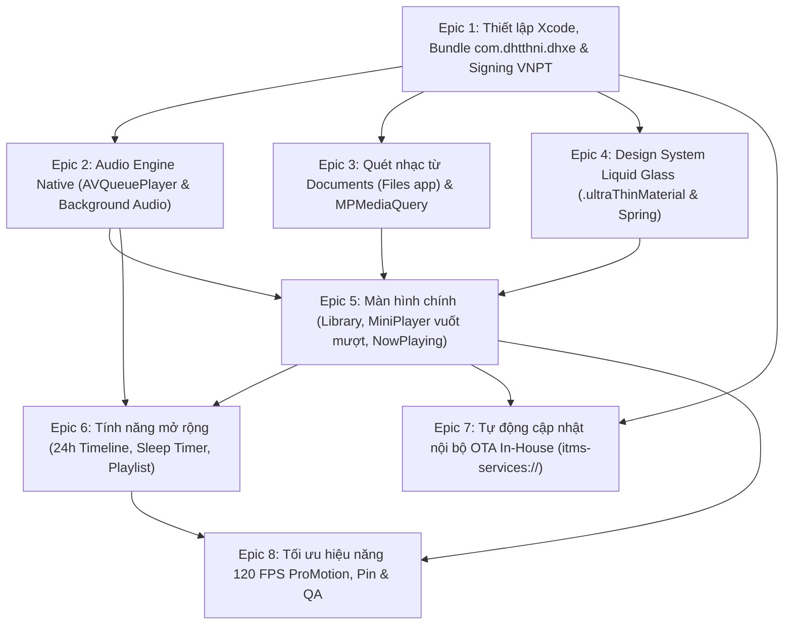

# 🍏 EPICS: PHÁT TRIỂN ỨNG DỤNG iOS OFFLINE MUSIC PLAYER (SWIFTUI)

> **Dự án**: Music Player (Mô hình Monorepo: `android/` & `ios/`)  
> **Nền tảng**: iOS 15.0+ Native (Swift 5.9+, SwiftUI, AVFoundation)  
> **Hình thức phát hành**: Phân phối nội bộ doanh nghiệp (**Apple Developer Enterprise In-House Distribution**).  
> **Định hướng thiết kế**: Chuẩn mực nguyên bản **Apple Music x Liquid Glass** (AMOLED Black, Frosted Glass Materials, Spring Physics).

---

## 🔐 THÔNG TIN ĐỊNH DANH & KÝ SỐ DOANH NGHIỆP (ENTERPRISE IDENTITY)

Dự án iOS sử dụng bộ chứng chỉ và cấu hình ký số doanh nghiệp từ thư mục [`docs/dev-ios/`](../docs/dev-ios):

| Thông số ký số | Giá trị chuẩn xác từ Profile & Certificate | Ý nghĩa & Vị trí áp dụng |
| :--- | :--- | :--- |
| **Bundle Identifier** | `com.dhtthni.dhxe` | Định danh gói ứng dụng trong Xcode & `Info.plist` |
| **App ID Prefix / Team ID** | `JPMH34L85K` | Apple Developer Team Identifier |
| **Application Identifier** | `JPMH34L85K.com.dhtthni.dhxe` | App ID đầy đủ được Apple cấp phép trong Profile |
| **Doanh nghiệp sở hữu (Team Name)** | `VIETNAM POSTS AND TELECOMMUNICATIONS GROUP - HO CHI MINH CITY TELECOM BRANCH` | Đơn vị chủ quản Enterprise Account (VNPT TP.HCM) |
| **Tệp Chứng chỉ (.p12)** | `VNPT_Enterprise_iOS Distribution_18082029.p12` *(Bảo mật cục bộ)* | Chứng chỉ phân phối In-House (Hạn dùng: **18/08/2029**) |
| **Tệp Provisioning Profile** | `Prov_HNI_comdhtthnidhxe.mobileprovision` *(Bảo mật cục bộ)* | Profile In-House: `Prov_HNI_com.dhtthni.dhxe` |
| **UUID Profile** | `309d9c0d-3f81-40ab-919f-e9c4a6405773` | UUID của Provisioning Profile (Hạn dùng: **21/10/2027**) |
| **Loại phân phối (Distribution Type)** | **Universal In-House (`ProvisionsAllDevices = true`)** | Cài đặt được trên **mọi thiết bị iOS nội bộ**, không cần khai báo UDID |

---

## 🧭 1. TỔNG QUAN KIẾN TRÚC MONOREPO & ĐỊNH HƯỚNG DỰ ÁN

Dự án được tái cấu trúc thành mô hình đa nền tảng độc lập (Dual-Native Monorepo):
- **`android/`**: Ứng dụng Android Native hoàn chỉnh (Kotlin, Jetpack Compose, AndroidX Media3 ExoPlayer, Room DB, Scoped Storage).
- **`ios/`**: Ứng dụng iOS Native hoàn toàn mới (Swift, SwiftUI, AVFoundation, MediaPlayer, File Sharing).

```text
├── android/                   # [HOÀN THIỆN & DUY TRÌ] Android Native App
│   ├── app/
│   ├── gradle/
│   ├── build.gradle.kts
│   └── gradlew.bat
├── ios/                       # [PHÁT TRIỂN MỚI] iOS SwiftUI App (com.dhtthni.dhxe)
│   └── MusicPlayer/
│       ├── App/               # Entry Point & Lifecycle
│       ├── Core/              # Audio, Storage, Theme, In-House Update
│       ├── Models/            # Domain Entities
│       ├── ViewModels/        # Observable ViewModels
│       ├── Views/             # SwiftUI Views & Liquid Glass Components
│       └── Resources/         # Info.plist & Assets
├── docs/                      # Tài liệu kỹ thuật, tiêu chuẩn UI/UX & Nhật ký
│   └── dev-ios/               # Chứa Certificate p12 và Mobileprovision VNPT
└── README.md                  # Tài liệu tổng quan Monorepo
```

### Lợi thế vượt trội của phương án Native SwiftUI với Enterprise In-House:
1. **Trải nghiệm Apple Music chuẩn 100%**: Sử dụng trực tiếp `.ultraThinMaterial` và hệ thống chuyển động đàn hồi của iOS không qua giả lập.
2. **Audio Engine gốc độ trễ cực thấp**: Trực tiếp kết nối `AVQueuePlayer` với `AVAudioSession` và `MPNowPlayingInfoCenter` (hỗ trợ Dynamic Island, Control Center, Apple Watch).
3. **Phân phối nội bộ không giới hạn**: Chứng chỉ `ProvisionsAllDevices = true` cho phép cài đặt trực tiếp qua giao thức OTA (`itms-services://`), cập nhật tự động ngay trong ứng dụng tương tự như file APK trên Android.

---

## 🛠️ 2. MA TRẬN ĐỐI CHIẾU CÔNG NGHỆ (ANDROID NATIVE vs iOS NATIVE)

| Hạng mục | Android Native (`android/`) | iOS Native (`ios/`) | Ghi chú kỹ thuật |
| :--- | :--- | :--- | :--- |
| **Bundle ID / Package** | `com.apple.android.music` | `com.dhtthni.dhxe` | Định danh ứng dụng độc lập trên từng OS |
| **Ngôn ngữ** | Kotlin 2.0+ (Coroutines, Flow) | Swift 5.9+ (Swift Concurrency, Combine) | Cả hai đều hỗ trợ bất đồng bộ hiện đại |
| **Giao diện (UI)** | Jetpack Compose (Material 3) | SwiftUI (Declarative UI) | Khái niệm State, Recomposition/View Update tương đồng 1:1 |
| **Hiệu ứng Kính** | Modifier.blur() + Luminous border | `.background(.ultraThinMaterial)` | iOS xử lý blur trên GPU Metal nguyên bản cực mượt |
| **Audio Engine** | AndroidX Media3 (ExoPlayer) | `AVFoundation` (`AVQueuePlayer`) | Quản lý phát nhạc chất lượng cao, gapless playback |
| **Điều khiển ngoài màn hình** | MediaSessionService + MediaNotification | `MPNowPlayingInfoCenter` + `MPRemoteCommandCenter` | Điều khiển từ Lock Screen, Control Center, tai nghe |
| **Quét nhạc** | MediaStore ContentResolver | `LocalAudioScanner` (Documents + `MPMediaQuery`) | iOS dùng iTunes Sharing + Document Picker |
| **Bộ nhớ đệm (DB)** | Room Database (SQLite) | `SwiftData` / `GRDB.swift` / Codable FileStore | Lưu Playlist, bài hát yêu thích, lịch sử |
| **Kênh Cập nhật** | Tải APK từ GitHub Releases | In-House OTA Install (`itms-services://`) | Cài đè trực tiếp thông qua file `manifest.plist` |

---

## 📋 3. DANH SÁCH CHI TIẾT CÁC EPICS CHO DỰ ÁN iOS (SWIFTUI)



---

### 🏛️ EPIC 1: THIẾT LẬP DỰ ÁN SWIFTUI & CẤU HÌNH KÝ SỐ ENTERPRISE VNPT
*Mục tiêu*: Thiết lập dự án Xcode chuẩn mực, cấu hình Bundle ID `com.dhtthni.dhxe`, cài đặt chứng chỉ P12 và Mobileprovision In-House từ `docs/dev-ios/`.

- **Task 1.1 - Cấu hình Signing & Enterprise Identity trong Xcode**:
  - Đặt `PRODUCT_BUNDLE_IDENTIFIER = com.dhtthni.dhxe`.
  - Cấu hình `DEVELOPMENT_TEAM = JPMH34L85K`.
  - Nhập chứng chỉ: `VNPT_Enterprise_iOS Distribution_18082029.p12` vào Keychain (phân loại *iPhone Distribution*).
  - Cấu hình Provisioning Profile thủ công (Manual Signing):
    - `PROVISIONING_PROFILE_SPECIFIER = Prov_HNI_com.dhtthni.dhxe`
    - Profile UUID: `309d9c0d-3f81-40ab-919f-e9c4a6405773`
  - Thiết lập Target Deployment: iOS 15.0 trở lên.
- **Task 1.2 - Khai báo Capabilities & Quyền hệ thống (`Info.plist`)**:
  - Bật `UIBackgroundModes` chứa `audio` (cho phép phát nhạc liên tục khi khóa màn hình).
  - Bật `UIFileSharingEnabled = true` và `LSSupportsOpeningDocumentsInPlace = true` (kết nối app với ứng dụng Files và iTunes/Finder).
  - Khai báo `NSAppleMusicUsageDescription`: *"Ứng dụng cần quyền đọc thư viện nhạc ngoại tuyến của bạn để phát các bài hát có trên thiết bị."*
- **Task 1.3 - Thiết lập Cấu trúc Thư mục Codebase**:
  - Tổ chức code theo mô hình MVVM + Services (`App`, `Core`, `Models`, `ViewModels`, `Views`, `Resources`).

---

### 🎵 EPIC 2: AUDIO ENGINE NATIVE & KHẢ NĂNG CHẠY NỀN TOÀN DIỆN
*Mục tiêu*: Xây dựng hệ thống phát âm thanh chuyên nghiệp với `AVFoundation`, xử lý hoàn hảo việc chạy ngầm, ngắt cuộc gọi và điều khiển từ Control Center.

- **Task 2.1 - Triển khai `AudioPlayerService`**:
  - Khởi tạo `AVQueuePlayer` quản lý danh sách hàng đợi bài hát.
  - Cơ chế phát liên tục (Gapless Playback), Shuffle Mode, Repeat Mode (Off, One, All).
  - Lắng nghe và xuất ra luồng thời gian thực (`currentTime`, `duration`, `isPlaying`) qua `@Published` properties.
- **Task 2.2 - Cấu hình `AVAudioSession`**:
  - Thiết lập danh mục `.playback`, chế độ `.default`, policy `.longFormAudio`.
  - Bắt sự kiện ngắt âm thanh (`AVAudioSession.interruptionNotification`) khi có cuộc gọi đến hoặc báo thức để tự động dừng và phát lại nhạc khi hết ngắt.
  - Bắt sự kiện đổi đầu ra âm thanh (`AVAudioSession.routeChangeNotification`) để lập tức tạm dừng nhạc khi người dùng rút tai nghe hoặc ngắt Bluetooth.
- **Task 2.3 - Tích hợp `MPNowPlayingInfoCenter` & `MPRemoteCommandCenter`**:
  - Hiển thị tên bài hát, tên nghệ sĩ, album, thời lượng và ảnh bìa album trên Lock Screen, Control Center và Dynamic Island.
  - Đăng ký nhận lệnh từ Trung tâm điều khiển, tai nghe AirPods và Apple Watch: Play, Pause, Next, Previous, Seek position.
- **Task 2.4 - Ghi nhớ trạng thái phát nhạc (State Persistence)**:
  - Lưu bài hát đang phát dở và vị trí seek cuối cùng vào `UserDefaults` để tự động phục hồi khi mở lại ứng dụng.

---

### 📂 EPIC 3: CƠ CHẾ NHẬP NHẠC NGOẠI TUYẾN & QUẢN LÝ TỆP TIN CỤC BỘ
*Mục tiêu*: Đảm bảo người dùng iOS có thể đưa các tệp nhạc ngoại tuyến vào ứng dụng dễ dàng nhất.

- **Task 3.1 - Quét tệp từ thư mục Documents (Files App & iTunes File Sharing)**:
  - Quét đệ quy toàn bộ thư mục `Documents` của ứng dụng.
  - Hỗ trợ đầy đủ các định dạng phổ biến: `.mp3`, `.m4a`, `.flac`, `.wav`, `.aac`.
  - Tự động bỏ qua các tệp ẩn, tệp rác hệ thống hoặc các bản ghi âm ngắn dưới 10 giây.
- **Task 3.2 - Tích hợp Document Picker (`UIDocumentPickerViewController`)**:
  - Cung cấp nút "Nhập nhạc từ Tệp" trên giao diện.
  - Cho phép người dùng duyệt và chọn tệp hoặc toàn bộ thư mục từ iCloud Drive hoặc bộ nhớ iPhone để sao chép vào kho nhạc của app.
- **Task 3.3 - Quét thư viện nhạc máy qua `MPMediaQuery`**:
  - Yêu cầu cấp quyền `MPMediaLibrary.requestAuthorization`.
  - Quét các bài hát người dùng đã đồng bộ từ máy tính qua ứng dụng Music của iOS.
  - Tự động lọc bỏ các bài hát dính bản quyền đám mây Apple Music DRM.
- **Task 3.4 - Trích xuất Siêu dữ liệu (ID3 Metadata) & Ảnh bìa**:
  - Đọc `AVURLAsset.commonMetadata` để trích xuất Title, Artist, Album.
  - Trích xuất ảnh bìa nhúng (artwork data) và tạo cache hình ảnh kích thước tối ưu để tải nhanh.

---

### 🎨 EPIC 4: HỆ THỐNG DESIGN SYSTEM "APPLE MUSIC x LIQUID GLASS" NATIVE
*Mục tiêu*: Tái hiện trọn vẹn ngôn ngữ thiết kế sang trọng bằng chính các công cụ bản địa của SwiftUI.

- **Task 4.1 - Hệ thống Color Tokens chuẩn**:
  - Màu nhấn chính: `#FA2D55` (Apple Music Red).
  - Nền Dark Theme: `#000000` (AMOLED Black 100%).
  - Mặt phẳng thẻ (Surface): `#1C1C1E` và `#2C2C2E`.
  - Viền phát quang siêu mảnh (Luminous Rim): `rgba(255, 255, 255, 0.12)`.
- **Task 4.2 - ViewModifier Kính Lỏng (`LiquidGlassModifier`)**:
  - Kết hợp `.ultraThinMaterial` với nền mờ bán trong suốt.
  - Đổ bóng đa tầng (Dual-layer Drop Shadow) và viền sáng phát quang 0.75pt.
- **Task 4.3 - Spring Physics & Haptic Feedback**:
  - Áp dụng animation đàn hồi `.spring(response: 0.45, dampingFraction: 0.7)` cho ảnh bìa đĩa (thu phóng khi Play/Pause).
  - Tích hợp phản hồi rung xúc giác `UIImpactFeedbackGenerator(style: .medium)` khi bấm các nút điều khiển.

---

### 📱 EPIC 5: MÀN HÌNH VÀ CÁC LUỒNG TRẢI NGHIỆM CỐT LÕI (CORE SCREENS)
*Mục tiêu*: Xây dựng đầy đủ các màn hình chức năng chính với độ phản hồi tức thì và tương tác mượt mà.

- **Task 5.1 - Màn hình Thư viện (LibraryView)**:
  - Bố cục danh mục lớn: Bài hát, Album, Nghệ sĩ, Danh sách phát.
  - Hiển thị danh sách bài hát gần đây, nút quét lại thư viện nhạc.
- **Task 5.2 - Màn hình Danh sách bài hát (SongsView)**:
  - Danh sách bài hát dạng `List` mượt mà, phân trang ảo hóa.
  - Tính năng tìm kiếm tức thời (Search bar) và sắp xếp (theo tiêu đề, nghệ sĩ, thời lượng, ngày thêm).
- **Task 5.3 - Màn hình Album & Chi tiết Album (AlbumsView & AlbumDetailView)**:
  - Lưới `LazyVGrid` 2 cột hiển thị các album với ảnh bìa bo tròn 12pt và đổ bóng mềm.
  - Màn hình chi tiết album có ảnh bìa lớn ở header, nút "Phát tất cả" và "Trộn bài".
- **Task 5.4 - Mini Player nổi tương tác (Interactive MiniPlayer)**:
  - Thanh kính lỏng nổi ngay trên `TabView`.
  - Hỗ trợ cử chỉ vuốt lên (Swipe Up) mở màn hình phát lớn, vuốt ngang đổi bài.
- **Task 5.5 - Màn hình Phát toàn màn hình (NowPlayingView)**:
  - Mở dạng Sheet hoặc FullScreenCover với thanh Grabber kéo xuống để đóng.
  - Ảnh bìa đĩa kích thước lớn có hiệu ứng thu nhỏ khi Pause và nở lớn khi Play.
  - Thanh trượt bài hát chính xác, hiển thị thời gian đã nghe và thời gian còn lại.
  - Bộ nút điều khiển: Shuffle, Previous, Play/Pause, Next, Repeat.
- **Task 5.6 - Màn hình Cài đặt (SettingsView)**:
  - Tùy chọn nguồn phát, quét lại nhạc, xóa bộ nhớ đệm cache ảnh.
  - Kiểm tra bản cập nhật nội bộ OTA.

---

### 🎚️ EPIC 6: TÍNH NĂNG MỞ RỘNG (24H TIMELINE, EQUALIZER & SLEEP TIMER)
*Mục tiêu*: Đưa các tính năng cao cấp từ bản Android sang bản iOS.

- **Task 6.1 - Màn hình Ký ức 24 Giờ (24h Playback Activity Timeline)**:
  - Lưu lại lịch sử các mốc thời gian phát nhạc trong ngày.
  - Trực quan hóa thành biểu đồ trục thời gian, người dùng có thể chạm vào mốc cũ để nghe tiếp tại đúng thời điểm đó.
- **Task 6.2 - Hẹn giờ tắt nhạc thông minh (Sleep Timer)**:
  - Cung cấp các mốc hẹn giờ: 15 phút, 30 phút, 45 phút, 1 giờ hoặc "Hết bài hát hiện tại".
  - Tự động hạ dần âm lượng (Fade-out volume) trong 10 giây cuối trước khi dừng hẳn.
- **Task 6.3 - Quản lý Danh sách phát (Custom Playlists)**:
  - Tạo mới, đổi tên, xóa Playlist.
  - Thêm bài hát vào Playlist, sắp xếp lại thứ tự bài hát bằng cử chỉ kéo thả (`onMove`).

---

### 🔄 EPIC 7: CƠ CHẾ TỰ ĐỘNG CẬP NHẬT NỘI BỘ (IN-HOUSE OTA UPDATE VỚI BUNDLE ID `com.dhtthni.dhxe`)
*Mục tiêu*: Xây dựng giải pháp cập nhật không dây tự động cho ứng dụng doanh nghiệp mà không cần nộp lên Apple Store.

- **Task 7.1 - Thiết kế tệp Manifest cấu hình cập nhật**:
  - Chuẩn bị file `manifest.plist` chứa Bundle ID chuẩn `com.dhtthni.dhxe`:
    ```xml
    <?xml version="1.0" encoding="UTF-8"?>
    <!DOCTYPE plist PUBLIC "-//Apple//DTD PLIST 1.0//EN" "http://www.apple.com/DTDs/PropertyList-1.0.dtd">
    <plist version="1.0">
    <dict>
        <key>items</key>
        <array>
            <dict>
                <key>assets</key>
                <array>
                    <dict>
                        <key>kind</key>
                        <string>software-package</string>
                        <key>url</key>
                        <string>https://ota.your-server.vn/ios/MusicPlayer.ipa</string>
                    </dict>
                </array>
                <key>metadata</key>
                <dict>
                    <key>bundle-identifier</key>
                    <string>com.dhtthni.dhxe</string>
                    <key>bundle-version</key>
                    <string>1.0.0</string>
                    <key>kind</key>
                    <string>software</string>
                    <key>title</key>
                    <string>Music Player</string>
                </dict>
            </dict>
        </array>
    </dict>
    </plist>
    ```
- **Task 7.2 - Mô-đun `InHouseUpdater` trong ứng dụng**:
  - Khi mở app hoặc khi người dùng bấm "Kiểm tra cập nhật" trong Cài đặt, app gọi API kiểm tra số phiên bản.
  - Nếu có bản mới: Hiển thị hộp thoại thông báo kèm ghi chú cập nhật và nút "Cập nhật ngay".
- **Task 7.3 - Kích hoạt cài đặt qua giao thức `itms-services`**:
  - Khi người dùng đồng ý cập nhật, app gọi:
    `UIApplication.shared.open(URL(string: "itms-services://?action=download-manifest&url=https://ota.your-server.vn/ios/manifest.plist")!)`
  - Hệ điều hành iOS sẽ tự động tải file `.ipa` đã ký bằng chứng chỉ VNPT Enterprise và cài đè phiên bản mới lên máy mà không cần máy tính.

---

### ⚡ EPIC 8: TỐI ƯU HIỆU NĂNG, PIN VÀ BẢO ĐẢM CHẤT LƯỢNG (PERFORMANCE & QA)
*Mục tiêu*: Đảm bảo ứng dụng đạt chuẩn 120 FPS mượt mà trên màn hình ProMotion, không hao pin ngầm và không rò rỉ bộ nhớ.

- **Task 8.1 - Tối ưu Bộ nhớ Đệm Hình ảnh (Image Cache & Downsampling)**:
  - Giảm độ phân giải ảnh bìa album về kích thước thực tế hiển thị (Downsampling tại chỗ) trước khi đưa lên UI.
  - Ngăn ngừa tình trạng tràn RAM (Out-Of-Memory) khi lướt danh sách hàng nghìn bài hát.
- **Task 8.2 - Tối ưu Pin & Chạy ngầm (Battery Optimization)**:
  - Giải phóng tài nguyên `AVAudioSession` khi người dùng dừng nhạc quá 15 phút.
  - Kiểm tra mức tiêu hao năng lượng trong công cụ Xcode Energy Organizer.
- **Task 8.3 - Kiểm thử Tự động (XCTest)**:
  - Unit Test cho `AudioPlayerService`, `LocalAudioScanner` và các ViewModels.
  - UI Test cho các luồng điều hướng và cử chỉ vuốt mở NowPlayingView.

---

## 📅 4. LỘ TRÌNH TRIỂN KHAI DỰ KIẾN (ROADMAP 4 TUẦN TINH GỌN)

```text
TUẦN 1: NỀN TẢNG, SIGNING VNPT & AUDIO ENGINE
├── Cấu hình Signing Xcode với Bundle ID com.dhtthni.dhxe & p12 VNPT (Epic 1)
└── Hoàn thiện AudioPlayerService, AVAudioSession & Remote Command Center (Epic 2)

TUẦN 2: QUÉT TỆP TIN & DESIGN SYSTEM NATIVE
├── Triển khai LocalAudioScanner (Documents Sharing + MPMediaQuery) (Epic 3)
└── Xây dựng Design System Liquid Glass, ColorTokens & Spring Physics (Epic 4)

TUẦN 3: GIAO DIỆN CHÍNH & MÀN HÌNH NÂNG CAO
├── Hoàn thiện Library, Songs, Albums Grid, MiniPlayer, NowPlaying (Epic 5)
└── Xây dựng 24h Timeline, Sleep Timer có fade-out & Quản lý Playlist (Epic 6)

TUẦN 4: OTA UPDATE IN-HOUSE & NGHIỆM THU HIỆU NĂNG
├── Triển khai tự động cập nhật nội bộ qua itms-services manifest.plist (Epic 7)
└── Đo kiểm hiệu năng 120 FPS, tối ưu bộ nhớ đệm và đóng gói phát hành (Epic 8)
```
