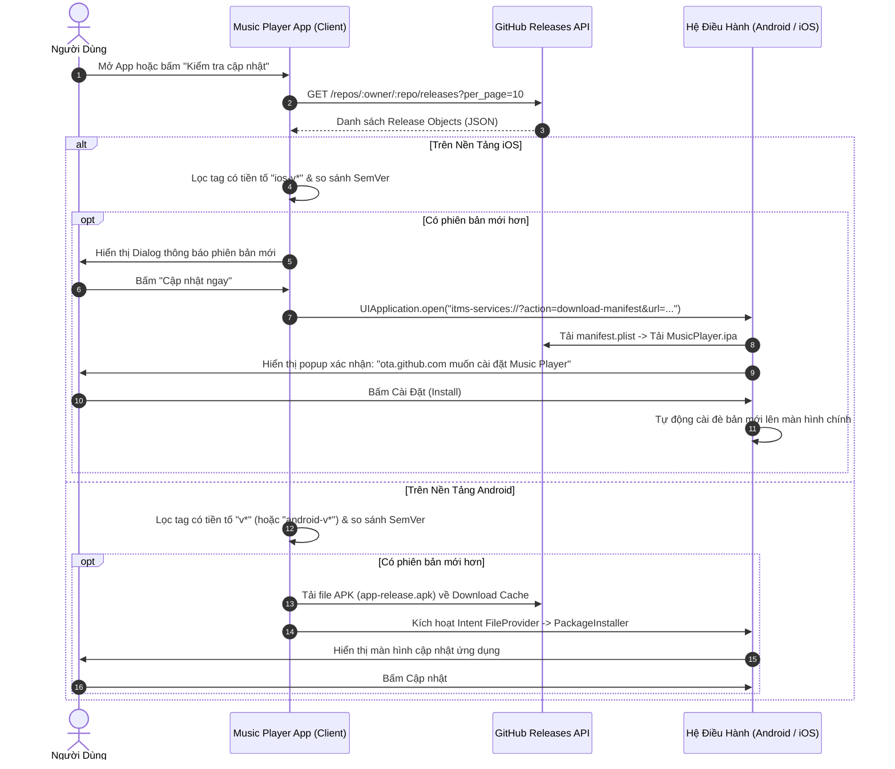

# 🛰️ KIẾN TRÚC TỰ ĐỘNG CẬP NHẬT ỨNG DỤNG KHÔNG DÂY (OTA UPDATE ARCHITECTURE)

> **Tham chiếu học tập**: Kế thừa trực tiếp giải pháp từ dự án [`mdm-parental-control`](file:///d:/PROJECT/github.com/mdm-parental-control).  
> **Phạm vi**: Ứng dụng **Android Native** (APK) và **iOS Native** (Enterprise In-House IPA).  
> **Máy chủ lưu trữ phát hành**: GitHub Releases công khai / nội bộ.

---

## 🧭 1. TỔNG QUAN KIẾN TRÚC DUAL-PLATFORM OTA

Cả hai nền tảng Android và iOS cùng chia sẻ chung một Repository GitHub Releases nhưng hoàn toàn không bị xung đột nhờ cơ chế phân tách tiền tố Git Tag (Tag Prefix Partitioning).



---

## 🏷️ 2. QUY CHUẨN PHÂN BIỆT BẢN PHÁT HÀNH TRÊN GITHUB RELEASES

| Hạng mục | Ứng dụng Android Native (`android/`) | Ứng dụng iOS Enterprise (`ios/`) |
| :--- | :--- | :--- |
| **Tiền tố Git Tag** | `vX.Y.Z` (hoặc `android-vX.Y.Z`) | `ios-vX.Y.Z` |
| **Tiêu đề Release** | `Release vX.Y.Z` | `Music Player iOS vX.Y.Z (Enterprise In-House)` |
| **Tệp đính kèm (Assets)** | `app-release.apk` | `MusicPlayer-ios-X.Y.Z.ipa`<br>`manifest.plist`<br>`MusicPlayer-ios-X.Y.Z-qr.png` |
| **Cơ chế Client nhận dạng** | `tag.startsWith("v") && !tag.startsWith("ios")` | `tag.startsWith("ios-v")` |
| **Cách thức cài đặt** | Android `PackageInstaller` / `FileProvider` | Apple `itms-services://?action=download-manifest&url=...` |

---

## 📲 3. GIẢI PHÁP CHI TIẾT CHO NỀN TẢNG iOS (SWIFTUI)

### 3.1. Cấu trúc tệp Manifest Apple OTA (`manifest.plist`)
Hệ điều hành iOS yêu cầu một tệp XML Plist định dạng chuẩn của Apple, được lưu trữ trên kết nối HTTPS:

```xml
<?xml version="1.0" encoding="UTF-8"?>
<!DOCTYPE plist PUBLIC "-//Apple//DTD PLIST 1.0//EN" "http://www.apple.com/DTDs/PropertyList-1.0.dtd">
<plist version="1.0">
<dict>
    <key>items</key>
    <array>
        <dict>
            <key>assets</key>
            <array>
                <dict>
                    <key>kind</key>
                    <string>software-package</string>
                    <key>url</key>
                    <string>https://github.com/:owner/:repo/releases/download/ios-vX.Y.Z/MusicPlayer-ios-X.Y.Z.ipa</string>
                </dict>
            </array>
            <key>metadata</key>
            <dict>
                <key>bundle-identifier</key>
                <string>com.dhtthni.dhxe</string>
                <key>bundle-version</key>
                <string>X.Y.Z</string>
                <key>kind</key>
                <string>software</string>
                <key>title</key>
                <string>Music Player</string>
            </dict>
        </dict>
    </array>
</dict>
</plist>
```

### 3.2. Mã nguồn Client iOS: `InHouseUpdater.swift`
Tại tầng ứng dụng iOS, mô-đun `InHouseUpdater.swift` đảm nhiệm:
1. Truy vấn GitHub API `GET /repos/khuongnv/android-music-player/releases`.
2. Lọc đúng tag bắt đầu bằng `ios-v`.
3. So sánh SemVer với `Bundle.main.infoDictionary?["CFBundleShortVersionString"]`.
4. Tìm file `manifest.plist` trong danh sách `assets`.
5. Tạo đường dẫn OTA:
   ```swift
   let otaLink = "itms-services://?action=download-manifest&url=\(manifestDownloadUrl)"
   UIApplication.shared.open(URL(string: otaLink)!)
   ```
6. Khi đường dẫn này được kích hoạt, iOS tự động hiển thị popup cài đặt của hệ điều hành mà không cần mở trình duyệt Safari.

---

## 🛠️ 4. QUY TRÌNH BUILD & DEPLOY TỰ ĐỘNG HÓA

### 4.1. Kịch bản triển khai đa nền tảng: `.agents/skills/deploy-app/scripts/deploy.ps1`

- **Phát hành riêng Android**:
  ```powershell
  powershell -ExecutionPolicy Bypass -File .agents/skills/deploy-app/scripts/deploy.ps1 -Platform android -BumpType patch
  ```
- **Phát hành riêng iOS**:
  ```powershell
  powershell -ExecutionPolicy Bypass -File .agents/skills/deploy-app/scripts/deploy.ps1 -Platform ios -CustomVersion "1.0.1" -ReleaseNotes "Nâng cấp giao diện Now Playing & Kính mờ Liquid Glass."
  ```
- **Phát hành đồng thời cả hai**:
  ```powershell
  powershell -ExecutionPolicy Bypass -File .agents/skills/deploy-app/scripts/deploy.ps1 -Platform all -CustomVersion "1.1.0"
  ```

### 4.2. Kịch bản chuyên sâu iOS: `deploy_ios.ps1`
1. Đọc và bump version trong `ios/MusicPlayer/Resources/Info.plist`.
2. Kết nối tới máy Mac M1 Pro (`100.111.29.5`), nạp chứng chỉ VNPT Enterprise (`.p12`) và mobileprovision (`com.dhtthni.dhxe`).
3. Đồng bộ mã nguồn `ios/` và chạy `xcodebuild archive` + `xcodebuild -exportArchive`.
4. Kéo file IPA về máy, sinh file `manifest.plist` từ template.
5. Tạo mã QR Code tải nhanh bằng API QR Server.
6. Tạo Git tag `ios-vX.Y.Z` và phát hành GitHub Release thông qua `gh release create`.
7. Gửi thông báo tổng kết hoàn tất kèm mã QR Code về kênh Telegram **HUB-LOG**.

---

## 🛡️ 5. BẢO MẬT & XỬ LÝ LỖI (SECURITY & TROUBLESHOOTING)

1. **Lỗi "Untrusted Enterprise Developer" trên iOS**:
   - Khi cài đặt ứng dụng lần đầu qua OTA, iOS sẽ yêu cầu người dùng tin cậy chứng chỉ doanh nghiệp:
   - Hướng dẫn người dùng: Vào **Cài đặt (Settings)** -> **Cài đặt chung (General)** -> **Quản lý VPN & Thiết bị (VPN & Device Management)** -> Chọn doanh nghiệp **VIETNAM POSTS AND TELECOMMUNICATIONS GROUP** -> Bấm **Tin cậy (Trust)**.
2. **Yêu cầu kết nối HTTPS**:
   - Giao thức Apple `itms-services://` bắt buộc tệp `manifest.plist` và file `.ipa` phải nằm trên URL **HTTPS** hợp lệ có chứng chỉ SSL/TLS công khai (GitHub Releases đáp ứng 100% tiêu chí này).
3. **Tránh xung đột bộ nhớ đệm (Cache Invalidation)**:
   - Mỗi phiên bản có một file `manifest.plist` riêng đính kèm trực tiếp trong Git Tag Release tương ứng, đảm bảo người dùng luôn tải đúng phiên bản mới nhất mà không bị cache trình duyệt.

